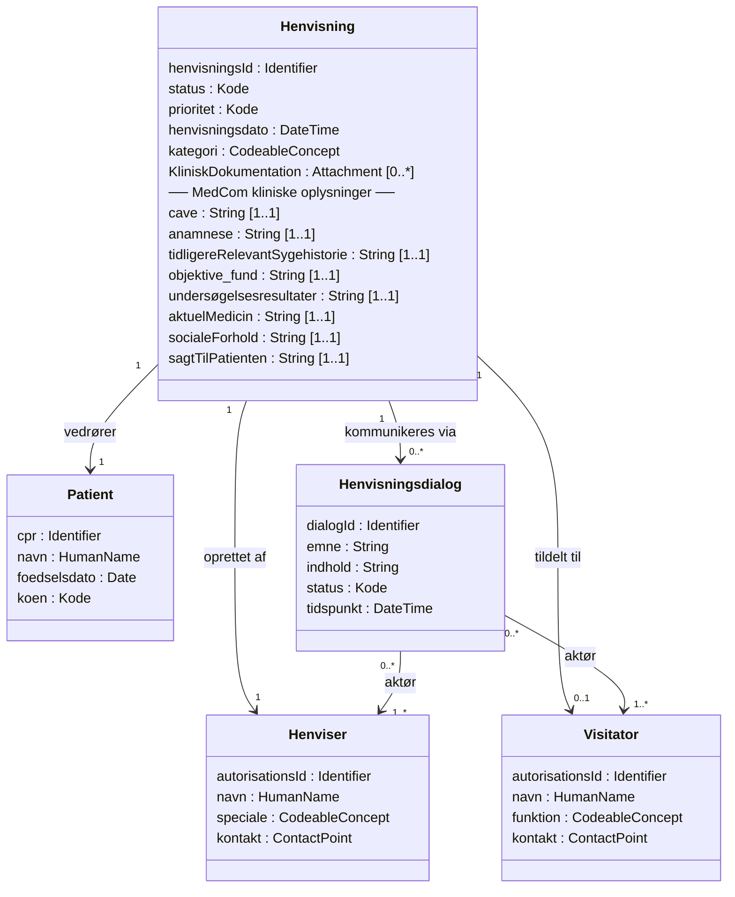
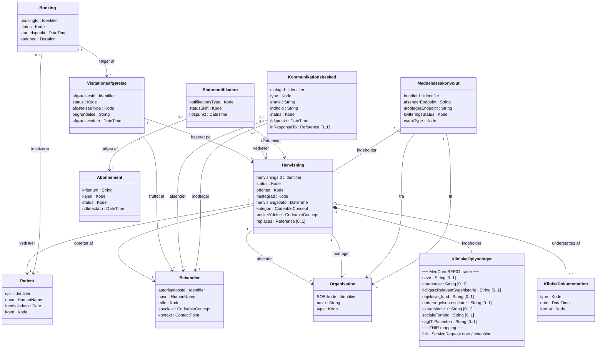

# Entitet: Henvisning

**FSH LogicalModel:** `LmHenvisning`

**Primær FHIR-ressource:** `ServiceRequest`

**User stories:** 1.1, 1.3, 1.4, 2.3, 2.4, 2.5, 2.6, 3.6

---

## Beskrivelse

`Henvisning` er den centrale entitet i hele flowet. Den repræsenterer en
klinisk anmodning om at viderehenvise en patient til et specialtilbud,
en undersøgelse eller en behandling. Alle øvrige entiteter relaterer sig
direkte eller indirekte til Henvisningen.

En Henvisning gennemgår en veldefineret livscyklus fra oprettelse til
afslutning og kan undervejs blive rettet, tilbagekaldt, videresendt
eller resultere i en booking.

---


## Logisk model for Henvisning og dialog imkring denne

Den logiske model for Henvisning og dialog imkring denne ser således ud skåret ind til benet.

Modellen er fokuseret og afspejler kerneflowet: én Henvisning som omdrejningspunkt, de to behandlerroller som separate klasser med stereotype-labels, og Henvisningsdialog som den fælles kommunikationsentitet. Modellen er grov og nogle elementer vil nok have sin egen entitet, når det modelleres i bund, men for at illustrere et overblik er det dækkende.
Perfekt. Jeg inkluderer dem begge steder — som attributter på `Henvisning` i din PUML-inspirerede model, og som en udvidelse af den større FHIR-logiske model.Her er begge modeller som Mermaid-kode klar til at indsætte direkte i din markdown-fil.

---

**Model 1 — Din kompakte model med de 8 fraser**



---

**Model 2 — Den fulde FHIR-logiske model med de 8 fraser**

Her er det et designvalg værd at nævne: de 8 fraser lever i FHIR på `ServiceRequest.note` (fritekst) eller som navngivne extensions, men logisk er de attributter på `Henvisning`. Jeg modellerer dem som en navngiven komponent `KliniskeOplysninger` der aggregeres ind på `Henvisning`, så de ikke drukner i den lange attributliste men stadig er eksplicit tilstede.



---

Et par noter til brugen:

`KliniskeOplysninger` er modelleret med **komposition** (`*--`) på `Henvisning` — det markerer at den ikke eksisterer uafhængigt. I FHIR-implementeringen svarer det til at de 8 fraser placeres i `ServiceRequest.note`-elementet som sektionerede tekster (én note-entry per frase med en `note.text`-overskrift), eller alternativt i en dansk extension `dk-medcom-referral-notes`. Begge tilgange er gyldige, og valget bør afklares i implementeringsguiden.

`aktuelMedicin` skal i praksis trækkes fra FMK frem for at leve som fritekst i henvisningen — det er eksplicit angivet i MedComs retningslinjer ("FMK skal være ajourført"). Det er værd at notere i implementeringsguiden at dette felt er en reference/pointer snarere end en kopi.
## Livscyklus

```
[proposed]  →  oprettet og afsendt (1.1)
    │
    ▼
[active]    →  modtaget og under behandling hos visitator
    │
    ├── [on-hold]    →  afventer supplement (3.1)
    │       └── [active]  →  supplement modtaget (3.2)
    │
    ├── [on-hold]    →  afventer klinisk afklarende dialog (x.x)
    │       └── [active]  →  klinisk afklarende dialog med opdateret henvisning færdiggjort (x.x)
    │
    ├── [revoked]   →  tilbagekaldt af henviser (1.4) eller afvist (2.4)
    │
    └── [completed] →  accepteret og booklet (2.3)
```

---

## Relaterede entiteter

- **[Patient](02-patient.html)** — subjektet for henvisningen
- **[Behandler](03-behandler.html)** — den der opretter og afsender
- **[Organisation](04-organisation.html)** — afsender og modtager
- **[KliniskDokumentation](05-klinisk-dokumentation.html)** — vedlagt materiale
- **[Visitationsafgoerelse](06-visitationsafgoerelse.html)** — udfaldet af visitationen
- **[Booking](07-booking.html)** — den aftalte tid ved accept
- **[Kommunikationsbesked](08-kommunikationsbesked.html)** — dialog om henvisningen
- **[Statusnotifikation](09-statusnotifikation.html)** — notifikationer ved statusskift

---

## User stories

### Henviserens user stories

- [user-story-11-oprette-en-ny-henvisning](fhir-henvisning-user-stories-v2-claude.html#user-story-11-oprette-en-ny-henvisning)

- [user-story-13-ændre-en-afsendt-henvisning](fhir-henvisning-user-stories-v2-claude.html#user-story-13-ændre-en-afsendt-henvisning)

- [user-story-14-tilbagekalde-en-henvisning](fhir-henvisning-user-stories-v2-claude.html#user-story-14-tilbagekalde-en-henvisning)

### Visitatorens user stories

- [user-story-23-acceptere-en-henvisning-og-booke-forløb](fhir-henvisning-user-stories-v2-claude.html#user-story-23-acceptere-en-henvisning-og-booke-forløb)

- [user-story-24-afvise-en-henvisning](fhir-henvisning-user-stories-v2-claude.html#user-story-24-afvise-en-henvisning)

- [user-story-25-videresende-til-anden-modtager](fhir-henvisning-user-stories-v2-claude.html#user-story-25-videresende-til-anden-modtager)

- [user-story-26-ændre-prioritet-på-en-modtaget-henvisning](fhir-henvisning-user-stories-v2-claude.html#user-story-26-ændre-prioritet-på-en-modtaget-henvisning)

### Udvekslingsdialog (fælles user stories)

Disse user stories forudsætter aktiv kommunikation frem og tilbage mellem henviser og visitator via FHIR-beskeder.

- [user-story-36-korrektionsaftale-om-fejl-i-afsendt-henvisning](fhir-henvisning-user-stories-v2-claude.html#user-story-36-korrektionsaftale-om-fejl-i-afsendt-henvisning)


## Attributter

| Attribut | Kardinalitet | Type | Beskrivelse |
|---|---|---|---|
| `henvisningsId` | 1..1 | Identifier | Unik identifikator for henvisningen |
| `status` | 1..1 | code | `proposed` · `active` · `on-hold` · `revoked` · `completed` |
| `prioritet` | 1..1 | code | `routine` · `urgent` · `asap` · `stat` |
| `oprettetDato` | 1..1 | dateTime | Tidspunkt for oprettelse |
| `aendretDato` | 0..1 | dateTime | Tidspunkt for seneste rettelse |
| `ydelseskode` | 1..1 | CodeableConcept | Ønsket ydelse eller specialale (SKS/SNOMED CT) |
| `indikation` | 1..* | CodeableConcept | Klinisk indikation / diagnose |
| `kliniskNote` | 0..1 | string | Anamnese, aktuelle problemer, begrundelse (fri tekst) |
| `oensketTidspunkt` | 0..1 | dateTime | Ønsket tidspunkt for undersøgelse eller behandling |
| `erstattetAf` | 0..1 | Reference(Henvisning) | Reference til ny/revideret henvisning (`replaces`) |
| `patient` | 1..1 | Reference(Patient) | Den patient der viderehenvises |
| `henviser` | 1..1 | Reference(Behandler) | Den behandler der opretter og afsender |
| `afsenderOrganisation` | 1..1 | Reference(Organisation) | Afsendende organisation |
| `modtagerOrganisation` | 1..1 | Reference(Organisation) | Modtagende organisation (visitator) |
| `dokumentation` | 0..* | Reference(KliniskDokumentation) | Vedlagte kliniske bilag og resultater |
| `booking` | 0..1 | Reference(Booking) | Tilknyttet booking ved accept |
{: .grid}
---

## FHIR-mapping

| Logisk attribut | FHIR-element | Kommentar |
|---|---|---|
| `henvisningsId` | `ServiceRequest.identifier` | Lokalt journal-nr. + evt. SOR-baseret id |
| `status` | `ServiceRequest.status` | Bundet til `request-status` (required) |
| `prioritet` | `ServiceRequest.priority` | Bundet til `request-priority` (required) |
| `oprettetDato` | `ServiceRequest.authoredOn` | |
| `aendretDato` | `ServiceRequest.meta.lastUpdated` | |
| `ydelseskode` | `ServiceRequest.code` | SKS-procedurekode eller SNOMED CT |
| `indikation` | `ServiceRequest.reasonCode` | SKS-diagnosekode eller SNOMED CT |
| `kliniskNote` | `ServiceRequest.note.text` | |
| `oensketTidspunkt` | `ServiceRequest.occurrenceDateTime` | |
| `erstattetAf` | `ServiceRequest.replaces` | Anvendes ved videresendelse (2.5) |
| `patient` | `ServiceRequest.subject` | Reference til DkCorePatient |
| `henviser` | `ServiceRequest.requester` | Reference til Practitioner/PractitionerRole |
| `afsenderOrganisation` | `ServiceRequest.requester` (via PractitionerRole) | |
| `modtagerOrganisation` | `ServiceRequest.performer` | Reference til DkCoreOrganization |
| `dokumentation` | `ServiceRequest.supportingInfo` | References til DiagnosticReport, DocumentReference m.fl. |
| `booking` | `ServiceRequest.basedOn` (Appointment) | Oprettes ved accept (2.3) |
{: .grid}

---

